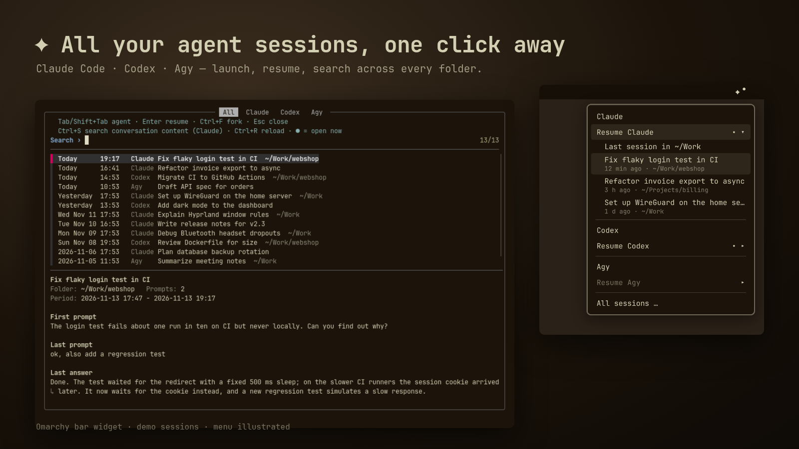
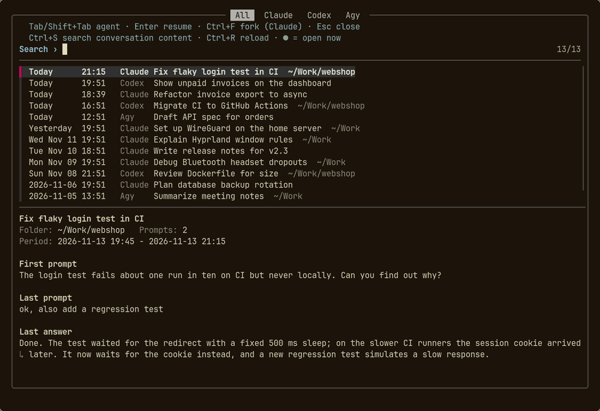
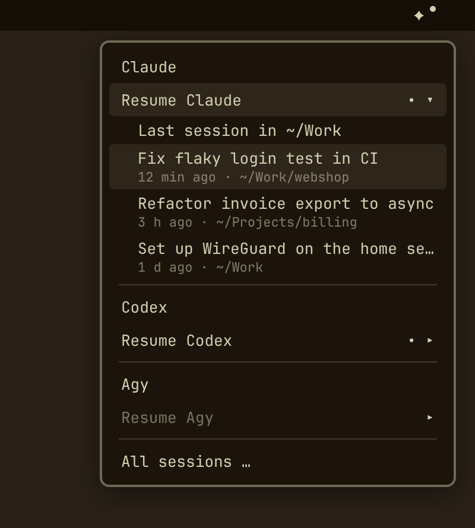
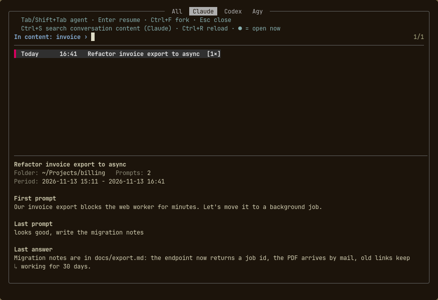

# AI Agent Launchers for Omarchy



One icon in the Omarchy bar for **Claude Code**, **Codex** and **Agy / Antigravity**: start an agent, resume a session, or find *any* earlier session across all folders – like the chat sidebar in Claude, but for your coding agents. The session window also lists **opencode** and, experimentally, **Copilot CLI**, **Pi**, **Gemini CLI** and **Grok**.

- **Launch and resume** each agent from a small context menu.
- **Running and recent sessions** per agent, with title, state and folder.
- **All sessions …** opens a floating window with every session of every agent found on the machine: agent choice, filter, preview, search in the conversation content, and fork for a follow-up question (Claude).
- **Quota at a glance** in the tooltip, read from local usage records only.
- English or German, following your system language.

## Why this one

- **Search inside conversations, across agents.** Ctrl+S finds a word in the prompts and answers of your Claude, Codex, Agy and opencode sessions, not only in their titles, with a hit count per session.
- **Never two clients on one transcript** (Claude, Codex): resuming a session that is already open focuses its window instead of starting it a second time.
- **Fork instead of derail** (Claude): ask a side question in a copy of the session; the original stays untouched.
- **Nothing running in the background.** No service, no network, no extra dependency besides `fzf`; it only reads the agents' own files when you open the menu or the window.

## See it in action



| Menu | All sessions |
|---|---|
|  |  |

Search in the conversation content (Ctrl+S), with hits from all three agents:



All pictures show invented demo sessions. The menu is an HTML illustration of the real widget ([`docs/screenshots/menu.html`](docs/screenshots/menu.html)); the window pictures and the animation are real screenshots.

## Install

From the Omarchy plugin marketplace, or:

```bash
omarchy plugin add https://github.com/mstio/mst.agent-launchers --enable
```

Update: `omarchy plugin update mst.agent-launchers`. Remove:

```bash
omarchy plugin disable mst.agent-launchers
omarchy plugin remove mst.agent-launchers
```

**Requirements:** Omarchy (Quattro bar), `python3`, `hyprctl` (focus an open session), `notify-send`. For the *All sessions* window also `fzf` ≥ 0.74 (tested with 0.74.5; it uses `transform`, labels and `wrap-word`; an older fzf gets a message). Optional: `rg` for a faster content search. The agents themselves (`claude`, `codex`, `agy`) only need to be installed if you want to use them.

## Quick start

1. After installing, the **✦** icon appears on the right of the bar.
2. Click it. *Claude*, *Codex* or *Agy* starts that agent in `~/Work`; *Resume … ▸* lists its running and recent sessions.
3. Click **All sessions …**: Tab switches the agent, typing filters the titles, **Ctrl+S** searches the conversations, **Enter** resumes the selected session in its own folder.
4. Optional: choose the language ([Settings](#settings)) or put the window on a key ([All sessions](#all-sessions)).

## The menu

| Action | Effect |
|---|---|
| Left / right click | toggle the menu below the icon |
| Middle click | refresh the local status |
| Click outside | close the menu |

| Row | Effect |
|---|---|
| Claude / Codex / Agy | start `claude`, `codex`, `agy` in `~/Work` (in your home if `~/Work` does not exist) |
| Resume … ▸ | expand the sessions of that agent (one agent at a time) |
| All sessions … | open the window described below |

Under **Resume … ▸** you get first *Last session in ~/Work* (`claude --continue`, `codex resume --last`, `agy -c`), then the running and recent sessions of that agent: last 14 days, at most 6, running ones first and marked **●**, each with title, state (*working*, *waiting*) or age, and folder.

- Running session (Claude, Codex) → its window is focused, no second client on the same transcript; if its window cannot be found, you get a notification instead (see [Troubleshooting](#troubleshooting)).
- Older session → resumed in its own folder: `claude --resume <id>`, `codex resume <id>`, `agy --conversation <id>`.

A small **•** on the icon means at least one agent has a resumable session in `~/Work`; resume rows with a detected session carry a **•**, the others are dimmed (still clickable).

## All sessions

The last menu row opens a floating terminal with all local sessions, newest first: every session whose folder still exists below `$HOME` (for Claude: with at least one prompt of your own). The agent choice sits at the top of the window frame: **All · Claude · Codex · Agy**, plus a tab for each further agent that has sessions on this machine.

| Agent | List and resume | Preview with prompts and answer | Content search | Tested on real sessions |
|---|---|---|---|---|
| Claude Code, Codex, Agy | ✓ | ✓ | ✓ | ✓ |
| opencode | ✓ (`opencode --session`) | ✓ | ✓ | ✓ |
| Copilot CLI, Pi, Gemini CLI, Grok | ✓ (`copilot --resume`, `pi --session`, `gemini --resume`, `grok --resume`) | title, folder, last use | – | experimental |

Experimental means: store locations and formats follow [omarchy-session-browser](https://github.com/Sudhanshugtm/omarchy-session-browser) and its test data, the resume flags were checked against the installed CLIs (Gemini CLI excepted), but no real session of these agents was available for testing. Reports with a sample are welcome.

| Key | Effect |
|---|---|
| Tab / Shift+Tab | next / previous agent |
| typing | filter titles |
| Enter | resume in a new terminal in the session's folder; if it is already open, focus its window |
| Ctrl+F | Claude: fork for a follow-up question (`--resume --fork-session`); the original transcript stays unchanged |
| Ctrl+S | search the typed text in the conversation content of the current agent view (prompts and answers, not tool output), with hit count per session |
| Ctrl+R | reload the current agent view (clears the filter and leaves the content search) |
| Esc | close |

- Row: `●` = open now, `󰄡` (Nerd Font `md-cellphone_link`) = open and reachable via Claude Remote Control; the dim number after the title is the context of the last request in tokens (Claude, Codex, Agy).
- Preview: folder, period and how long ago, duration and how long the agent actually worked (Claude: `turn_duration` records, Codex: from task start to completion), context (Codex also as share of the model's window), model, tokens in and out (input with the share served from cache), for open Claude sessions whether the agent is working or waiting for input; then number of prompts, first and last prompt, last answer (Codex: its final answer, otherwise the last interim note). No costs: with a subscription they would only be a notional API price.
- The window uses the app id `TUI.float`, which Omarchy already floats and centers; no window rule needed.
- Own key binding (optional), e.g. in `~/.config/hypr/bindings.lua`:

  ```lua
  o.bind("SUPER + ALT + H", "Agent sessions", "omarchy-launch-tui --app-id=TUI.float ~/.config/omarchy/plugins/mst.agent-launchers/bin/agent-sessions")
  ```

  Add `--lang de` or `--lang en` at the end to match a `language` setting of the widget. The script `bin/agent-sessions` can also be run directly in any terminal.

## Settings

Optional, in the widget's entry in `~/.config/omarchy/shell.json`:

```json
{ "id": "mst.agent-launchers", "language": "de" }
```

`language`: `en`, `de`, or leave it out to follow the system language (`LC_ALL`, `LC_MESSAGES`, `LANG`; German for `de_*`, otherwise English).

## Quota in the tooltip

Hovering the icon shows, per agent, whether a resumable `~/Work` session was found and the locally cached quota:

- Claude and Codex: Omarchy's own usage records `~/.local/state/omarchy/agents/usage/{claude,codex}.json` (the same collector as Omarchy's Agents panel).
- Agy: Omarchy-style records (`agy.json`, `antigravity.json`, `gemini.json`), then compatible local caches such as `~/.gemini/antigravity-cli/usage-limits.json`. Without one, the tooltip points to `/usage` inside Agy.

The plugin never reads or prints OAuth tokens and never calls a quota API itself.

## Limitations

- **Menu** covers Claude Code, Codex and Agy; further agents appear only in the window. Copilot CLI, Pi, Gemini CLI and Grok are experimental there (see the table under [All sessions](#all-sessions)); sessions whose id is shorter than 8 characters or contains other characters than letters, digits, `-` and `_` are skipped.
- **Running sessions** are detected for Claude and Codex only; for the other agents Enter resumes even if the session is already open somewhere. Agy keeps a readable transcript only for some conversations.
- **Fork** exists for Claude only.
- **Focusing** needs one Hyprland window per session; inside tmux or another multiplexer you get a notification instead.
- **Not listed:** sessions whose folder was deleted or lies outside `$HOME` or in `/tmp` (they cannot be resumed there), internal Codex runs, and Claude sessions without a prompt of your own.
- **Content search** is a plain, case-insensitive text match, no regular expressions.
- **Formats:** the agents' transcript formats are undocumented and may change with updates; unexpected records are skipped instead of emptying the list.

## Troubleshooting

| Problem | What to check |
|---|---|
| The ✦ icon does not appear | `omarchy plugin list` should show it enabled; otherwise `omarchy plugin enable mst.agent-launchers`. |
| The window only shows a message about fzf | `fzf --version` must be 0.74 or newer; install or update the `fzf` package. |
| A session is missing | Was its folder moved or deleted, or is it in `/tmp` or outside your home? See [Limitations](#limitations). |
| "Already open, but its window was not found" | The session runs in tmux or another terminal multiplexer: switch to it there, or use Ctrl+F (Claude) to continue in a fork. |
| Ctrl+S finds nothing in a session you remember | Only prompts and answers are searched, not tool output; some Agy conversations have no readable transcript. |
| Wrong language | Set `language` in the widget's entry ([Settings](#settings)). |
| No quota in the tooltip | Claude and Codex: the records come from Omarchy's own collector `omarchy-agent-usage-update` (run by Omarchy's Agents widget); enable that widget or run the command once. Agy: use `/usage` inside Agy. |

## Privacy and safety

The plugin only **reads**, and only these files:

| What | Files | When |
|---|---|---|
| Claude sessions | `~/.claude/projects/*/*.jsonl`, `~/.claude/sessions/*.json` (or below `$CLAUDE_CONFIG_DIR`; from the latter only state, status and whether a Remote Control id is set, never its value) | menu, window |
| Codex sessions | `~/.codex/session_index.jsonl`, `~/.codex/sessions/**/rollout-*.jsonl` (first line for the lists, the window also the last 256 KB for context and tokens, the whole file for preview and search) | menu, window |
| Agy sessions | below `~/.gemini/antigravity-cli/`: `cache/conversation_metadata.json`, `cache/last_conversations.json`; for preview and search `brain/<id>/.system_generated/logs/transcript_full.jsonl` (or `transcript.jsonl`) | menu, window |
| opencode sessions | `~/.local/share/opencode/opencode.db` (sessions without archived and sub-agent ones), opened read-only (`mode=ro`, `query_only`): the content is never changed, but like any reader SQLite may create or refresh its helper files `opencode.db-shm` / `-wal` | window |
| Experimental agents | `~/.copilot/session-state/*/events.jsonl` and `history-session-state/*.json`, `~/.pi/agent/sessions/**/*.jsonl`, `~/.gemini/tmp/*/chats/session-*.json(l)` and `.project_root`, `~/.grok/sessions/*/*/summary.json` and `subagents/*/meta.json` (or below `$GROK_HOME`); event logs only their first lines, JSON files up to 2 MB (Gemini's older single-file form up to 20 MB) | window |
| Running agents | `/proc`: which agent process runs and which window it belongs to | menu, window |
| Quota | the usage files above; JSON files named after Agy (`*agy*`, `*antigravity*`, `*gemini*`, never `*token*`, `*auth*`, `*oauth*`, `*credential*`) below `~/.local/state/omarchy` and `~/.cache/omarchy` | tooltip, every 60 s |

- **No network, no service.** The session lists are read only when you open the menu (~0.5 s) or the window. Never the `.key` files next to the session files.
- **Index cache** `~/.cache/agent-sessions/index.json` for Claude in the window, mode 0600 because it contains prompt excerpts; rebuilt per file by mtime and size, safe to delete. Codex and Agy texts are read directly, without a cache; their token counts are cached in `~/.cache/agent-sessions/metrik.json` (0600, numbers only).
- **Untrusted text:** titles and conversation texts are model output; control, C1, bidi and zero-width characters are stripped before display, and the menu renders them as plain text.
- **Resuming** only uses a checked session id (letters, digits, dashes) in an existing folder: the window starts it as an argument list without a shell and only for folders below `$HOME`; the menu runs a shell line with the folder quoted (`shlex.quote`).
- No automatic agent switching, no change of the Omarchy default agent, no `--dangerously-skip-permissions`.

## Development

```bash
python3 -m unittest discover -s tests
omarchy plugin validate .
```

After QML changes: `omarchy restart shell`. Screenshots: invented demo sessions from `docs/screenshots/make-demo-home.py <demo-home>`; the window via `omarchy-launch-tui --app-id=TUI.float env HOME=<demo> … bin/agent-sessions --lang en`, `wtype` for the keys and `grim` per frame (the animation is assembled with ImageMagick); `menu.html` and `hero.html` rendered with a headless Chromium.

## Credits

The *All sessions* window is based on the `claude-sitzungen` experiment by [bernhard2804](https://github.com/bernhard2804), proposed in [mstio/polaris-connector#3](https://github.com/mstio/polaris-connector/pull/3).

Where opencode, Copilot CLI, Pi, Gemini CLI and Grok keep their sessions, and how sub-agent sessions are marked, was learned from [omarchy-session-browser](https://github.com/Sudhanshugtm/omarchy-session-browser) by Sudhanshu Gautam (MIT); the code here is our own.

## License

[MIT](LICENSE)
