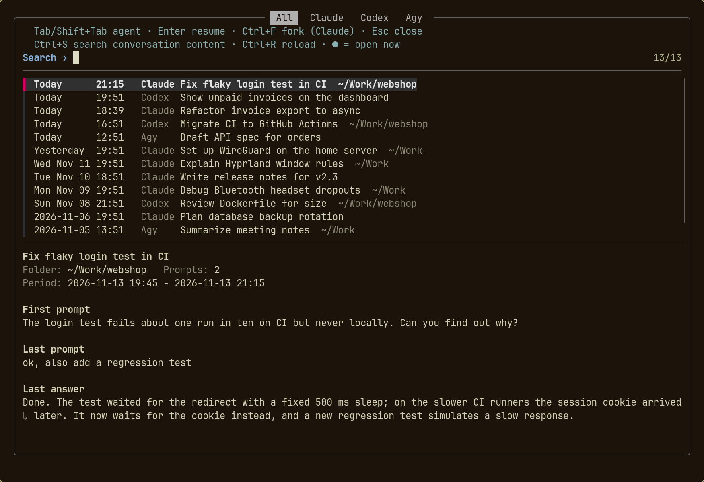

# AI Agent Launchers for Omarchy


One icon in the Omarchy bar for **Claude Code**, **Codex** and **Agy / Antigravity**: start an agent, resume a session, or find *any* earlier session across all folders – like the chat sidebar in Claude, but for your coding agents.

- **Launch and resume** each agent from a small context menu.
- **Running and recent sessions** per agent, with title, state and folder. A session that is already open gets its window focused instead of a second client on the same transcript.
- **All sessions …** opens a floating window with all sessions of all three agents (those whose folder still exists in your home): agent choice, filter, preview, search in the conversation content, and fork for a follow-up question (Claude).
- **Quota at a glance** in the tooltip, read from local usage records only.
- English or German, following your system language.

No service, no timer for the session list, no network: everything is read from the agents' own local files when you open the menu or the window.

## Screenshots

| Menu | All sessions |
|---|---|
|  |  |

Search in the conversation content (Ctrl+S):


All screenshots show invented demo sessions. The menu is an HTML illustration of the real widget ([`docs/screenshots/menu.html`](docs/screenshots/menu.html)); the windows are real screenshots.

## Install

From the Omarchy plugin marketplace, or:

```bash
omarchy plugin add https://github.com/mstio/mst.agent-launchers --enable
```

Update: `omarchy plugin update mst.agent-launchers`. Remove:

```bash
omarchy plugin disable mst.agent-launchers
omarchy plugin remove mst.agent-launchers
```

**Requirements:** Omarchy (Quattro bar), `python3`, `hyprctl` (focus an open session), `notify-send`. For the *All sessions* window also `fzf` ≥ 0.74 (tested with 0.74.5; it uses `transform`, labels and `wrap-word`; an older fzf gets a message). Optional: `rg` for a faster content search. The agents themselves (`claude`, `codex`, `agy`) only need to be installed if you want to use them.

## The menu

| Action | Effect |
|---|---|
| Left / right click | toggle the menu below the icon |
| Middle click | refresh the local status |
| Click outside | close the menu |

| Row | Effect |
|---|---|
| Claude / Codex / Agy | start `claude`, `codex`, `agy` in `~/Work` (in your home if `~/Work` does not exist) |
| Resume … ▸ | expand the sessions of that agent (one agent at a time) |
| All sessions … | open the window described below |

Under **Resume … ▸** you get first *Last session in ~/Work* (`claude --continue`, `codex resume --last`, `agy -c`), then the running and recent sessions of that agent: last 14 days, at most 6, running ones first and marked **●**, each with title, state (*working*, *waiting*) or age, and folder.

- Running session (Claude, Codex) → its window is focused, no second client on the same transcript; if its window cannot be found, e.g. inside tmux, you get a notification instead. Agy sessions are not detected as running.
- Older session → resumed in its own folder: `claude --resume <id>`, `codex resume <id>`, `agy --conversation <id>`.

A small **•** on the icon means at least one agent has a resumable session in `~/Work`; resume rows with a detected session carry a **•**, the others are dimmed (still clickable).

## All sessions

The last menu row opens a floating terminal with all local sessions of all three agents, newest first: every session whose folder still exists below `$HOME` (for Claude: with at least one prompt of your own). The agent choice sits at the top of the window frame: **All · Claude · Codex · Agy**.

| Key | Effect |
|---|---|
| Tab / Shift+Tab | next / previous agent |
| typing | filter titles |
| Enter | resume in a new terminal in the session's folder; if it is already open, focus its window |
| Ctrl+F | Claude: fork for a follow-up question (`--resume --fork-session`); the original transcript stays unchanged |
| Ctrl+S | search the typed text in the conversation content of the current agent view (prompts and answers, not tool output), with hit count per session |
| Ctrl+R | reload the current agent view (clears the filter and leaves the content search) |
| Esc | close |

- Preview: folder, period, number of prompts, first and last prompt, last answer (Codex: its final answer, otherwise the last interim note). Agy keeps a readable transcript only for some conversations; for the others the preview shows title, folder and last use.
- The window uses the app id `TUI.float`, which Omarchy already floats and centers; no window rule needed.
- Own key binding (optional), e.g. in `~/.config/hypr/bindings.lua`:

  ```lua
  o.bind("SUPER + ALT + H", "Agent sessions", "omarchy-launch-tui --app-id=TUI.float ~/.config/omarchy/plugins/mst.agent-launchers/bin/agent-sessions")
  ```

  Add `--lang de` or `--lang en` at the end to match a `language` setting of the widget. The script `bin/agent-sessions` can also be run directly in any terminal.

## Settings

Optional, in the widget's entry in `~/.config/omarchy/shell.json`:

```json
{ "id": "mst.agent-launchers", "language": "de" }
```

`language`: `en`, `de`, or leave it out to follow the system language (`LC_ALL`, `LC_MESSAGES`, `LANG`; German for `de_*`, otherwise English).

## Quota in the tooltip

Hovering the icon shows, per agent, whether a resumable `~/Work` session was found and the locally cached quota:

- Claude and Codex: Omarchy's own usage records `~/.local/state/omarchy/agents/usage/{claude,codex}.json` (the same collector as Omarchy's Agents panel).
- Agy: Omarchy-style records (`agy.json`, `antigravity.json`, `gemini.json`), then compatible local caches such as `~/.gemini/antigravity-cli/usage-limits.json`. Without one, the tooltip points to `/usage` inside Agy.

The plugin never reads or prints OAuth tokens and never calls a quota API itself.

## Privacy and safety

- **Read-only** on the agents' own files: `~/.claude/projects/*/*.jsonl` and `~/.claude/sessions/*.json` (or `$CLAUDE_CONFIG_DIR`), `~/.codex/session_index.jsonl` and `~/.codex/sessions/**/rollout-*.jsonl` (first line for the list, the whole file for preview and content search), Agy's `cache/conversation_metadata.json`, `cache/last_conversations.json` and, for preview and content search, `brain/<id>/.system_generated/logs/transcript_full.jsonl` (or `transcript.jsonl`), `/proc` (which agent process is running, which window it belongs to). Never the `.key` files next to them. For the quota: the usage files listed above and JSON files named after Agy (`*agy*`, `*antigravity*`, `*gemini*`, never `*token*`, `*auth*`) below `~/.local/state/omarchy` and `~/.cache/omarchy`.
- **No network, no service.** The status for the tooltip is refreshed from local files every 60 s; the session list only when you open the menu (~0.5 s) or the window.
- **Index cache** `~/.cache/agent-sessions/index.json` for the window, mode 0600 because it contains prompt excerpts; it is rebuilt per file by mtime and size and can be deleted at any time. Codex and Agy are read directly, without a cache.
- Titles and texts are model output: control, C1, bidi and zero-width space characters are stripped before display, and the menu renders them as plain text.
- Resuming only uses a checked session id (letters, digits, dashes) in an existing folder: the window starts it as an argument list without a shell and only for folders below `$HOME`; the menu runs a shell line with the folder quoted (`shlex.quote`). Sessions in `/tmp` (e.g. automated runs) and internal Codex runs are skipped.
- No automatic agent switching, no change of the Omarchy default agent, no `--dangerously-skip-permissions`.
- The transcript formats of the agents are undocumented and may change with updates; unexpected records are skipped instead of emptying the list.

## Development

```bash
python3 -m unittest discover -s tests
omarchy plugin validate .
```

After QML changes: `omarchy restart shell`. Screenshots: invented demo sessions; the window via `omarchy-launch-tui --app-id=TUI.float env HOME=<demo> … bin/agent-sessions --lang en` and `grim`; `menu.html` and `hero.html` rendered with a headless Chromium.

## Credits

The *All sessions* window is based on the `claude-sitzungen` experiment by [bernhard2804](https://github.com/bernhard2804), proposed in [mstio/polaris-connector#3](https://github.com/mstio/polaris-connector/pull/3).

## License

[MIT](LICENSE)
